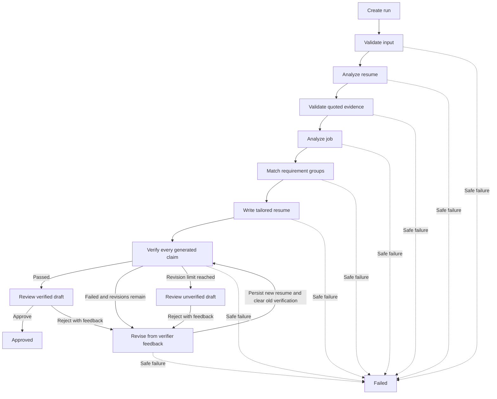
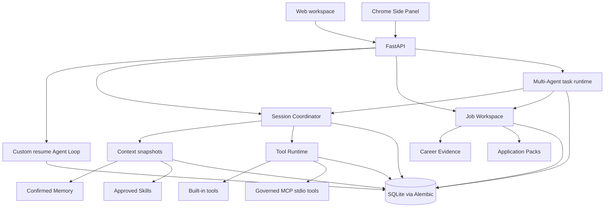
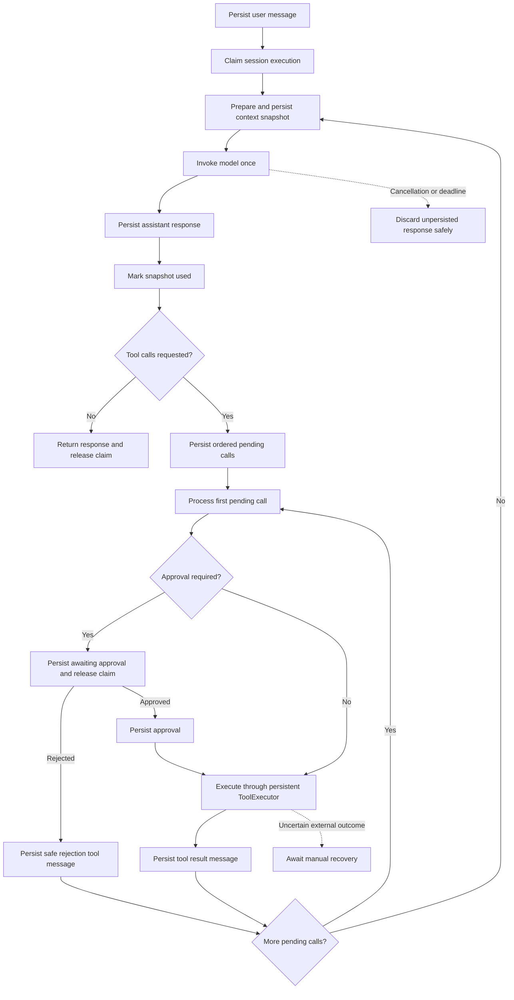
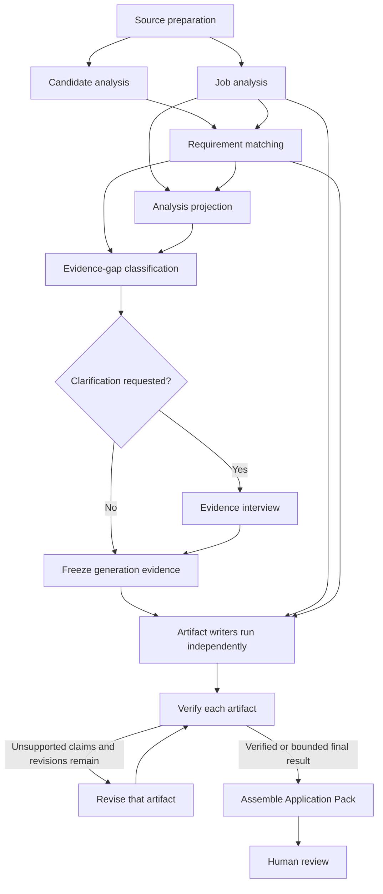

# JobHunterAgent

JobHunterAgent is a local-first career copilot for saving job postings, comparing
them with a resume, producing evidence-grounded application materials, and managing
the conversations and review steps around an application.

The project has two user-facing surfaces:

| Surface | Purpose |
|---|---|
| **Web workspace** | Full job workspace, resume management, Copilot conversations, application materials, evidence, interviews, and governed learning |
| **Chrome Side Panel** | Lightweight extraction and fit analysis for the job currently open in the browser |

The web workspace runs at `http://localhost:8000/app`. The extension always talks to
the same local service at `http://localhost:8000`.

## What it does

- Saves jobs with title, company, location, original URL, and a cleaned job description.
- Accepts selectable-text PDF resumes and keeps one resume as the default.
- Splits compound job requirements into deterministic requirement groups.
- Distinguishes matched, partial, missing, and user-confirmation requirements.
- Grounds generated resume claims in quoted resume or user-confirmed evidence.
- Verifies drafts and uses a bounded revision loop before human review.
- Generates tailored resumes, cover letters, and application answers as versioned artifacts.
- Exports tailored resumes as searchable, ATS-friendly Letter-size PDFs.
- Persists Copilot conversations and lists them in a ChatGPT-style sidebar.
- Supports resumable tool calls, approvals, cancellation, deadlines, and recovery.
- Opens public job pages, navigates application steps, fills confirmed candidate
  details, and supports secure account input for login or registration. Greenhouse,
  Lever and Workday entry flows have focused coverage; other sites use the generic loop.
- Keeps Memory and Skills governed, versioned, reviewable, and separate from resume evidence.

### Resume agent loop

The active custom backend persists state and an audit event after every completed
step. Human review is a durable pause rather than a long-running in-memory request.



Only `awaiting_review` and `approved` states publish a stable public result. During
revision, the latest complete result may remain stored for audit purposes, while the
run status shows that it is no longer the current completed version.

## Quick start

### 1. Create an environment

Windows PowerShell:

```powershell
py -m venv .venv
.\.venv\Scripts\Activate.ps1
python -m pip install -r requirements.txt
```

macOS or Linux:

```bash
python3 -m venv .venv
source .venv/bin/activate
python -m pip install -r requirements.txt
```

### 2. Configure the model

Create a `.env` file in the repository root:

```dotenv
LLM_MODEL_ID=your-model-id
LLM_API_KEY=your-api-key

# Optional for an OpenAI-compatible provider
LLM_BASE_URL=https://provider.example/v1

# Optional; defaults are provider timeout behavior and zero retries
LLM_TIMEOUT=60
LLM_MAX_RETRIES=0
```

`LLM_MAX_RETRIES=0` keeps one logical model invocation aligned with one provider
request during evaluations. Do not commit `.env`.

### 3. Initialize the database

```powershell
python -m alembic upgrade head
```

Production startup relies on Alembic. SQLAlchemy `create_all()` is used only by
isolated tests.

### 4. Start the local service

```powershell
python -m uvicorn api.main:app --host 127.0.0.1 --port 8000
```

Open:

- Web workspace: <http://localhost:8000/app>
- OpenAPI documentation: <http://localhost:8000/docs>
- Health check: <http://localhost:8000/health>

### 5. Complete the first-use setup

1. Open **Settings** in the web workspace.
2. Upload a PDF resume containing selectable text.
3. Save a job or install the Chrome extension.
4. Run **Analyze fit**.
5. Use Copilot or Materials to continue the application workflow.

The resume upload stores extracted text, document metadata, and a content hash in
SQLite. It does not retain the original PDF bytes. Scanned-image PDFs require OCR
and are rejected in the current version.

## Chrome extension

The extension is intentionally smaller than the web application. It can:

- detect the title, company, location, URL, and job description on the active page;
- automatically extract the visible LinkedIn job when the Side Panel opens;
- keep the extracted fields editable before anything is submitted;
- save the job into the web workspace;
- compare it with the default resume and show a match score and suggestions;
- open the saved application in the full web workspace.

**Analyze fit** uses the analysis-only pipeline: input validation, resume evidence
analysis, job analysis, and requirement matching. It makes three logical model calls
and does not write or verify a tailored resume, create a reviewable run, or enter
human review. Full `/runs` and Application Pack workflows retain the complete
write/verify/revise/review lifecycle.

Install it locally:

1. Start the FastAPI service.
2. Open `chrome://extensions`.
3. Enable **Developer mode**.
4. Select **Load unpacked**.
5. Choose the repository's `chrome_extension` directory.
6. Open a normal HTTP(S) job page and click the extension icon.

LinkedIn changes its page structure regularly. **Extract page** remains available
as a manual fallback. The extension never sends extracted text until the user
selects **Analyze fit** or **Save job**.

The extension requests only:

- `activeTab`
- `scripting`
- `storage`
- `sidePanel`
- host access to `http://localhost:8000/*`

It does not request broad browsing history, cookies, downloads, `webRequest`, or
`<all_urls>` access.

## Web workspace

### Jobs

Saved jobs keep their source URL and immutable description snapshots. Reopening a
job shows its latest analysis and application materials without requiring the
original page to remain open.

### Copilot

Copilot conversations are durable and listed in a left sidebar. Messages appear
optimistically while a model turn is running, and failed sends remain visible for
editing and retry. A conversation can be reopened or archived without deleting its
audit history.

Copilot uses a server-owned read-only capability profile. The browser cannot submit
arbitrary tools, model IDs, system prompts, API keys, or permission metadata.

### Materials

Application Packs contain versioned tailored resumes, cover letters, application
answers, verification results, and review state. Generated claims remain subject to
the same evidence rules during revision. Tailored resumes can be downloaded as PDF
or copied as text.

New resume drafts must bind every claim to a real extracted source entry and may not
use `legacy:*` source IDs. Entry headings, organizations, locations, and dates are
checked against that source entry before a draft is persisted. The explicit v1
artifact upgrader retains `legacy:*` IDs only so historical artifacts remain
readable; it is not a generation fallback.

### Evidence and learning

Career Evidence records user-confirmed facts independently from generated artifacts.
Conversation learning may propose Memory candidates, but only confirmed Memory can
enter future context. Memory confirmation never turns a statement into resume
evidence automatically.

Skills use standards-compatible `SKILL.md` packages with validation, hashing,
approval, activation, and retirement. Skill tool declarations may narrow runtime
permissions but cannot expand them.

### Interviews

Evidence interviews clarify missing application evidence. Mock interviews provide
job-specific practice and coaching. Both are persisted and can resume after a
process restart; neither may silently confirm new career evidence.

## Architecture



### Copilot and tool loop

Each model decision and each individual tool call has its own persistence boundary.
The coordinator never keeps a database transaction open while waiting for a provider
or tool.



The context snapshot fixes the exact policy, Skill versions, Memory versions,
conversation groups, evidence sources, and effective tools used for a model call.
Recovery reuses that snapshot instead of silently selecting newer context.

### Multi-Agent application workflow

The Multi-Agent runtime coordinates a server-defined application plan. It is an
opt-in orchestration path behind application preparation, not a separate chat persona
or a user-selectable execution-mode switch. The model cannot invent child agents,
dependencies, permissions, or budgets.



The runtime provides:

- **Deterministic planning.** Python builds and validates the DAG before any worker
  runs. Unknown task types, cycles, invalid dependencies, excessive depth, or budgets
  outside server limits are rejected.
- **Isolated child sessions.** Each task receives declared input artifacts and a
  scoped context. It does not inherit sibling conversations, arbitrary tools, or new
  permissions.
- **Dependency-aware scheduling.** `requires_success` blocks downstream work after a
  failed prerequisite; `requires_completion` lets pack assembly account for optional
  artifacts that ended without succeeding.
- **Bounded parallelism.** Ready tasks are claimed with leases and heartbeats, while
  the plan limits total tasks, depth, concurrent work, model calls, tool calls,
  tokens, cost, and deadlines.
  Model workers reserve call and token capacity before contacting the provider.
  Failed attempts retain their reservation when actual usage is unavailable;
  retries share the same persisted plan budget. Provider usage replaces token
  estimates when returned. Monetary cost caps are not supported yet: setting one
  blocks model calls instead of silently ignoring the cap.
- **Durable artifacts.** Analyses, evidence snapshots, drafts, verification reports,
  revisions, and the final pack are versioned outputs rather than hidden agent-to-agent
  messages.
- **Safe recovery.** Expired task claims can be recovered within attempt limits;
  cancellation, timeout, approval, and required user input remain explicit states.

The main application DAG currently prepares a tailored resume, cover letter, and up
to three application answers. Restricted questions remain manual. A failed required
artifact blocks final assembly, while optional artifacts are recorded according to
their terminal outcome. The resulting pack still requires human review.

Important boundaries:

- **Custom Agent is the active backend** for newly created runs.
- **The custom Agent Loop is the only execution backend** for the API, CLI, and
  workflow evaluations. The retired graph runtime and its dependencies are removed.
- Schemas, prompts, model configuration, domain rules, rendering, and evaluation
  datasets are shared where behavior must remain comparable.
- Saved results from historical runs remain readable. Runs whose stored backend
  is retired or unknown cannot be reviewed or resumed; create a new custom run.
  Historical backend labels remain in the database for provenance.
- Model and tool calls execute outside database transactions.

## Persistence and recovery

The default database is `job_agent.db`; custom state and audit events live in the
same database. Old checkpoint files are no longer opened or required. Existing
database files and archived evaluation reports are not deleted by this cleanup.
Override the active database with:

```dotenv
JOB_AGENT_DATABASE_URL=sqlite:///./job_agent.db
```

SQLite foreign keys are enabled on every connection. Business state, events, and
public projections are committed transactionally with optimistic version checks.
Session execution uses time-bounded claims so one active attempt owns a running
session.

Recovery guarantees are deliberately conservative:

- completed tool results can be replayed into a missing session message without
  executing the tool again;
- expired read-only, side-effect-free, idempotent calls may retry within limits;
- uncertain write calls become `outcome_unknown` and require manual recovery;
- provider model calls are at-least-once if a process stops before the response is
  durably persisted;
- no exactly-once claim is made for external side effects.

## Optional MCP tools

MCP support is limited to governed local `stdio` servers. Configuration is loaded
from `MCP_CONFIG_PATH`; see `examples/mcp/local_test_config.json` for the local test
server format.

MCP tools enter the same registry, policy, approval, timeout, idempotency, provenance,
and persistence path as built-in tools. Current support does not include Streamable
HTTP, OAuth, resources, prompts, sampling, or elicitation.

## API overview

The complete contract is available from `/docs`. Main endpoint groups are:

| Prefix | Purpose |
|---|---|
| `/runs` | Resume workflow runs and human review |
| `/sessions` | Persistent Copilot conversations, messages, approvals, cancellation, and recovery |
| `/api/workspaces`, `/api/applications` | Saved jobs and application workspaces |
| `/api/resumes` | PDF resume upload and default resume selection |
| `/api/packs` | Application Pack generation and review |
| `/api/evidence` | Governed Career Evidence |
| `/memories`, `/skills` | Memory and Skill lifecycle management |
| `/api/interviews`, `/api/mock-interviews` | Evidence discovery and interview practice |
| `/api/applications/{id}/multi-agent-runs`, `/api/multi-agent-runs` | Governed application task plans, progress, cancellation, and resumption |
| `/api/assistant-sessions` | Safe conversation timeline and registered actions |

Client-facing errors are normalized. API responses do not expose API keys, complete
tracebacks, SQL, local paths, raw system prompts, or private tool results.

## Testing

Run the complete Python suite:

```powershell
python -m pytest -q
```

Run the browser-side unit tests:

```powershell
node --test tests/test_copilot_ui.mjs tests/test_learning_ui.mjs tests/test_mock_interview_ui.mjs tests/test_web_ui.mjs
```

The historical release baseline before removal of the graph backend was:

```text
638 passed, 1 skipped
18 JavaScript tests passed
```

Current test totals change as retired-backend tests are replaced by custom-loop
coverage. Tests use fake models or scripted adapters by default and do not make paid model
calls. Live evaluations are opt-in. Reproducible datasets, runners, raw outputs, and
version metadata live under `evals/`.

GitHub Actions runs both commands on every push and pull request through
`.github/workflows/ci.yml`. It never runs a real-model evaluation. Live evaluations
remain explicit, paid, manual commands.

Human material-quality review uses 10–20 anonymized real resume/JD pairs and scores
factual accuracy, non-duplication, and application readiness. The governed local
packet format and privacy rules are in `evals/human_quality_review/README.md`.
Synthetic stability cases do not count as real-material review, and every failed
human review must identify a regression test before the packet validates.

Common evaluation commands:

```powershell
python -m evals.run_evals
python -m evals.run_stability_evals
python -m evals.run_requirement_intelligence_v3
```

These runners use the configured model and may make billable provider requests.
Unit tests remain offline by default.

Review the saved artifacts in `evals/results/` instead of combining results from
different prompt or dataset versions.

## Project layout

```text
JobHunterAgent/
|-- agent_runtime/       # Tool, session, context, memory, skill, MCP, and agent runtimes
|-- api/                 # FastAPI routes, schemas, dependencies, and services
|-- chrome_extension/    # Manifest V3 Side Panel extension
|-- custom_agent/        # Active persisted resume workflow loop
|-- job_agent/           # Shared schemas, prompts, model config, domain rules, rendering
|-- web_app/             # Full local web workspace
|-- migrations/          # Alembic schema history
|-- evals/               # Synthetic datasets, runners, and versioned results
|-- skills/              # Built-in, project, and generated Skill packages
|-- tests/               # Python and JavaScript tests
|-- examples/mcp/        # Local MCP example configuration and server
`-- scripts/             # Development smoke-test utilities
```

## Security and current limitations

This is a trusted, local, single-user application. It is not an authentication or
multi-tenant authorization boundary.

- Do not expose the service directly to an untrusted network.
- Resume text, job descriptions, feedback, generated artifacts, messages, and audit
  state are stored locally in SQLite.
- The browser extension treats webpage content as untrusted data and renders returned
  content with safe DOM APIs.
- Prompt instructions and structured output reduce risk, but deterministic evidence
  validation is the primary claim-safety boundary.
- SQLite is suitable for this local deployment, not high-throughput multi-worker use.
- Dynamic provider timeouts depend on provider support; Python cannot forcibly stop an
  in-flight remote request.
- LinkedIn extraction may require selector updates when its DOM changes.
- OCR, hosted authentication, cloud synchronization, automatic job submission, and
  login bypass are outside the current scope.

## Development policy

All executable workflows use the custom runtime. Archived evaluation reports
retain their original backend metadata and are historical evidence only. Database
changes require Alembic migrations, and tests should use isolated temporary SQLite
files rather than production `create_all()`.

### Command-line workflow

`python main.py resume.txt job.txt --thread-id application-001 --output result.json`
runs the same persisted custom Agent Loop as the API. Use a unique run ID for each
application; the CLI never overwrites an existing run. `--database-url` optionally
selects a separate database. A run paused for review can be reviewed through `/runs`
using the same database. A retired backend cannot be selected by environment settings.

## Browser application assistant (first release)

Open `/apply` from the web workspace's **Apply** link, or choose **Prepare
application** on a saved job. This uses a separate persisted custom observe/act/verify
loop under `agent_runtime/auto_apply`; it has no LangGraph dependency. The existing
resume-generation loop remains focused on producing and reviewing materials.

1. Install the updated `requirements.txt` and run `python -m alembic upgrade head`.
2. Start the local service with one worker. Chrome must be installed on this machine.
   Set `JOB_AGENT_BROWSER_CHANNEL=msedge` to use an installed Edge instead.
3. Attach the final resume PDF in the chat. Selectable text is sent to the configured
   model to extract evidenced contact and education details. Missing required details
   are asked in chat; **Your details** opens an optional profile editor.
4. Send a direct public HTTPS job link (for example Greenhouse, Lever or Workday).
   The chat starts Agent + autofill automatically.
   New chat applications always show a review card before submission. The API retains
   its existing explicit automation/submission settings for other clients.
5. Reply in the conversation; no question-selection dropdown or Continue click is
   needed. Short choices appear next to questions. **View workspace** opens the
   browser preview, plan, activity, completed answers and answer memory. **Pause agent
   & use Chrome** stops automation for manual interaction; send `continue` to resume.
   Review approval remains bound to the observed form and is invalidated by changes.

If the browser never opens, confirm that Playwright is installed in the **same
Python environment as the server**. Installing Chrome alone is not enough. After
pulling updated code, rerun `python -m pip install -r requirements.txt` in that
environment and restart the server. Missing Python browser dependencies pause the
attempt with setup instructions rather than automatically retrying.

For macOS, run these commands from the repository root (with Google Chrome installed):

```bash
.venv/bin/python -m pip install -r requirements.txt
.venv/bin/python -m uvicorn api.main:app --host 127.0.0.1 --port 8000
```

The default `chrome` channel uses the installed Google Chrome on Windows, macOS,
and Linux; it does not require a separate `playwright install` browser download.
After repairing the environment, choose **Try again** on the existing attempt.

Hybrid mode uses the existing `LLM_MODEL_ID`, `LLM_BASE_URL`, and `LLM_API_KEY`
configuration. The model must support native tool calls and image input for visual
backup. It chooses how to combine
deterministic `autofill`, individual field actions, and page navigation. Playwright
performs real browser input using DOM/ARIA locators or screenshot coordinates.
The visual backup uses the same model and browser session, rather than requiring
a provider-specific computer-use model or controlling the user's desktop.

Field observations include nearby groups, help, constraints and validation errors.
The agent also reads selectable text from the attempt's saved resume, including
work and project history. For open-ended questions it can compose a draft with
literal resume/chat evidence. Drafts appear in editable multiline answer boxes
with source excerpts; missing details such as an unreported measurable effect are
called out separately, without inventing results. Review or edit the draft and use
the existing **Submit answers & continue** button. Until then, the draft is kept
separate from confirmed answers, browser input and cross-application answer memory.
Existing attempts reuse their stored PDF; they do not require a new upload.

`resolve_field` lets the model adapt a sourced value to the site's representation
(including splitting an international phone), match an observed semantic option,
or choose an incidental default such as a handset classification. These run-local
decisions have provenance and are kept separate from confirmed answers/memory;
source corrections invalidate them. The review panel labels incidental defaults.
Material answers and consent still require explicit facts. This does not prevent
`equivalent` mappings of a supplied fact (for example an M.Eng. to an observed
Masters category); those cite this question's confirmed source, respect explicit
corrections, and never become default qualifications or new remembered facts.
`explore_option` opens
an observed category without requiring it to equal the user's intended leaf, then
reads its children or newly revealed dependent controls. Search text is distinct
from a committed selection. A rejected unchanged value is handed to the model for
repair instead of repeatedly being written by autofill.

It observes retained values after every action. **Visual browser backup** is an
explicit option in application details, disabled by default. When enabled, after
a failed DOM action (or when the model requests `view_browser`), the model sees
the current viewport and can click, double-click, hover, scroll, drag, type a known
source or press editing/navigation keys. Each action returns a fresh screenshot.
The model uses an explicit 0..1000 coordinate grid, mapped to the screenshot's CSS
pixel dimensions (also on high-DPI displays); old images are rejected
after page changes. The model can explore menus without DOM option roles. Actual
form values and errors still determine completion, not a successful mouse click.
Screenshots stay in memory, password/verification controls are masked, and account
pages use the secure account workflow. Candidate facts, fields and requested
screenshots are sent to the configured model. Changing the visual option applies
to the active attempt with the next chat message, including `continue`.
The model cannot navigate arbitrarily, execute page JavaScript, or submit directly.
Final validation and the submission boundary remain in the custom host loop.

The agent executes up to 12 decisions per worker slice and schedules the next slice
automatically while making progress. The task plan, recent actions and last tool
result survive slices. A user instruction/resume has a budget of 40 model calls and
120 tool calls; cumulative usage is retained. Transient failures have at most two
automatic recovery attempts with backoff. Waiting does not block other browser work,
and pause/cancel invalidates scheduled retries. Persistent failures surface a retry
action rather than asking for already supplied answers. Autofill failures are isolated
per field. Existing API clients can still select deterministic autofill mode.

Country aliases (for example US/USA/United States), phone-country suffixes, and
common school names/abbreviations are matched against observed options. School
acronyms with multiple matches pause rather than select an arbitrary campus.
Autocomplete searches can expand known aliases before retrieving options.

**Remember my answers** stores user-provided answers under the candidate email.
Equivalent questions on another application can reuse them, with their original
question shown beside the field. Work authorization preserves country context;
sponsorship and present/future scope are separate. Consent is asked on first use,
including optional consent controls, then reused for an equivalent question.
Generic "I agree" labels without scope are not reused. Candidate details in the
current resume/form take priority over older remembered contact/education answers.
Open **Remembered answers** to inspect or forget entries. Previously saved explicit
answers are indexed once on upgrade; forgetting an entry survives a restart.
Migration `0030_application_memory` adds the answer store.

Optional fields explicitly requested by the agent appear in the same question
list and answer controls as required fields. Voluntary demographic dropdowns use
confirmed answers or ask for the site's actual choices, including decline options;
they are never inferred from the resume. Newly revealed dependent questions are
handled after the preceding selection.

The original resume PDF and editable candidate details now persist locally across
new applications, page reloads and server restarts. **Your details** includes an
editable education history. Migration `0031_saved_candidate` adds this store;
the latest legacy application's resume is restored once and re-extracted to obtain
all education records. Removing the saved resume prevents legacy backfill from
restoring it again. Resume extraction uses the agent's ordinary tool-call transport
and validates each extracted fact against a literal quote from the PDF.

The agent sees confirmed answer memories with their original questions and can
reuse paraphrased questions through `use_remembered_answer`; consent, immigration
and employer-specific facts retain their scope. Education rows are associated with
individual saved records using `bind_education`. Autofill then fills each record's
school, degree, major and stated dates, including optional fields. Completion checks
prevent moving past an offered repeatable education section with missing records
or known details. Date components absent from the resume are not invented.

Inline questions keep selections as drafts. Choose all answers, then use
**Submit answers & continue** to save them in one request and resume the agent once.
Polling retains unsent choices; changing the question schema invalidates its draft.

The application chat persists user feedback and agent replies. Sending feedback
invalidates an outstanding model decision; the next decision sees the new message.
**Pause** stops subsequent actions and submission until you continue. The browser
panel shows local snapshots and named tool actions. The browser preview stays local;
the separate visual-backup option also sends requested viewport images to the model. This is a preview,
not a remote-control video stream; use the separate Chrome window to interact.

Each attempt stores its selected PDF, candidate details, explicit answers, observed
form state, and bounded event history in the local application database. Cookies and
passwords are not stored in that database; encrypted browser login state is described
below. The existing resume library retains extracted text rather
than original PDF bytes, so this release asks you to select the actual file to upload.

The runtime limits open active attempts to three and runs browser actions serially.
It re-observes after every fill, bounds execution time and action count, and detects
an unchanged unsuccessful action instead of clicking indefinitely. A unique posting
identity prevents duplicate attempts, including across tracking URLs and restarts.
Before a submit click it durably enters `submitting`. Missing confirmation, crashes,
or timeouts after that point become `submission_unknown`; there is no automatic
resubmission. Only an observed employer confirmation marks a run `submitted`.

Running/queued hybrid attempts resume on server startup from saved facts and answers.
Paused tasks remain paused; previously approved review screens require fresh review
after reopening the browser. The local backend and computer must stay running for
background execution. Unstarted chat drafts and the reusable upload are held in the
current page, while started applications and their chat are stored in the database.
Cancelling before submission preserves progress and offers **Resume application**.
Resuming reopens the same attempt, restores saved answers and drafts, and requires
a fresh final review. Sending an existing job link in a new chat opens its original
application instead of leaving the user at a duplicate error. An application that
has reached submission (including an uncertain result) cannot be restarted this way.
The browser now accepts public HTTPS job links beyond Greenhouse and Lever. The
LLM observes page text, application controls and the current form, and chooses when
to open Apply, import a resume, add a repeated section, or continue to the next
step. Final submission remains host-controlled, and a Next button does not count
as a completed application. Earlier-page answers stay available for review.

Workday account pages open a dedicated credential dialog. The agent can sign in
or register using the supplied email/password; the password is kept out of model
inputs, chat, application records and previews. Account agreements are shown with
the page's instructions and require explicit choices. Verification emails, MFA,
CAPTCHA and unrecognized authentication layouts pause for browser interaction.
Successful login cookies/local storage are encrypted with Windows DPAPI under
`.browser-sessions/`, isolated by candidate email and the initial job-site host.
Passwords themselves are not retained by the agent. Other operating systems retain
the current browser session but do not persist an unencrypted fallback. This is a
local Windows implementation, not a credential service for cloud deployment.

Hosted Greenhouse/Lever controls have regression coverage. Workday's public
application, email sign-in, and registration entry screens have been inspected;
account execution, multiple pages, and final review are tested using offline
fixtures. Other ATS links (including Ashby, SmartRecruiters, iCIMS, Taleo,
SuccessFactors and Jobvite) enter the same generic loop; URL acceptance is not a
claim of verified compatibility. Custom widgets, SSO redirects, unknown questions
and employer-specific steps can still require browser interaction. Job discovery
and cloud browser hosting are not included.
Attempts have their own history; they do not automatically change the saved
job's pipeline status. Use a single trusted local server process, not a public or
multi-tenant deployment.

Application tests (scripted model responses, no live model calls):

```powershell
python -m pytest tests/test_auto_apply.py tests/test_auto_apply_agent.py tests/test_auto_apply_personalization.py tests/test_auto_apply_conversation.py tests/test_auto_apply_autonomy.py -q
$env:JOB_AGENT_BROWSER_TESTS = "1"
python -m pytest tests/test_auto_apply_navigation.py tests/test_auto_apply_workday.py tests/test_auto_apply_browser.py -q
```

The Chrome tests intercept every employer request and use local fixture pages. They
cover actual browser filling, PDF upload, questions, review, confirmation, and the
web UI through the real API without submitting to an employer. Hybrid tests also
cover keyboard fallback, readonly portal dropdowns, replaced DOM nodes, background
requests during pauses, cancellation, stale observations, answer grounding, resume
extraction, cross-application memory, chat corrections, previews and forgetting.
These tests do not establish compatibility with every live model provider. Production selectors
were also checked against public read-only Greenhouse and Lever pages; this does not
establish success across every employer customization.

Implementation references: [Playwright input actions](https://playwright.dev/python/docs/input),
[Playwright locators](https://playwright.dev/python/docs/locators),
[Greenhouse job board documentation](https://docs.greenhouse.io/job-board.html),
and [Lever hosted application URLs](https://github.com/lever/postings-api).
