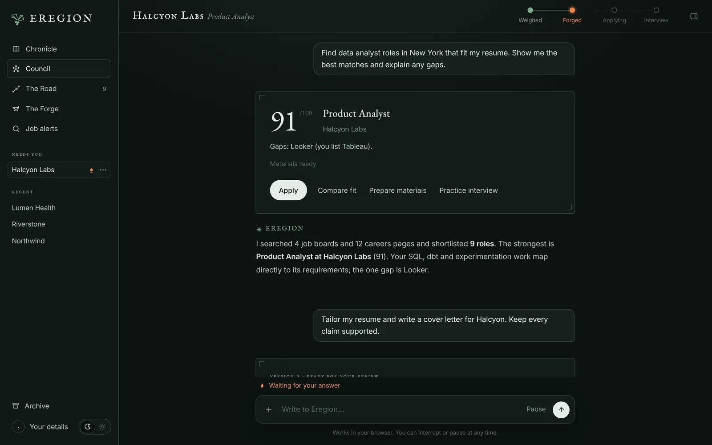
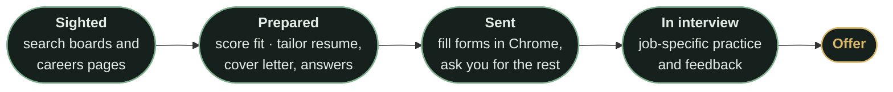
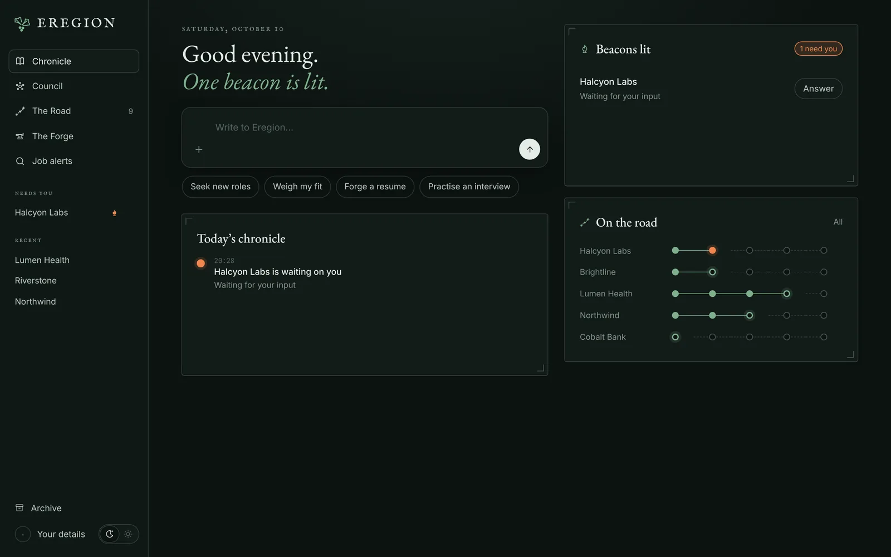
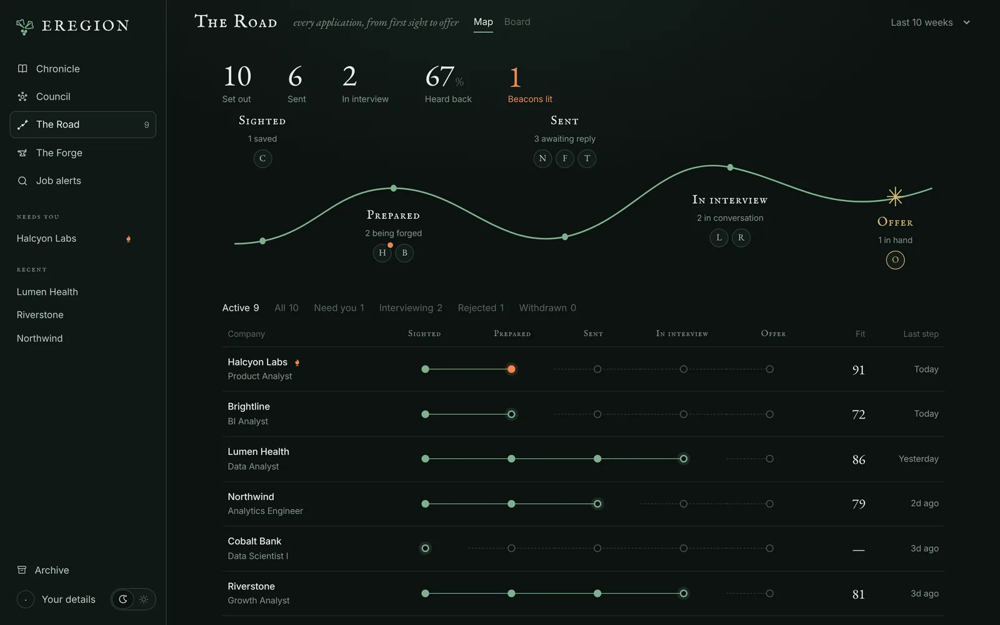
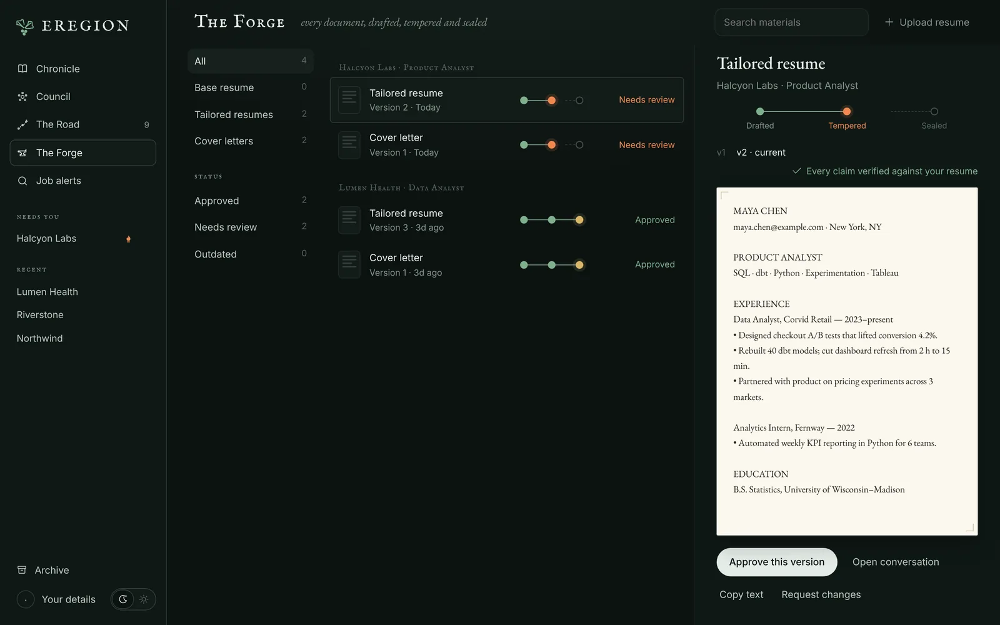
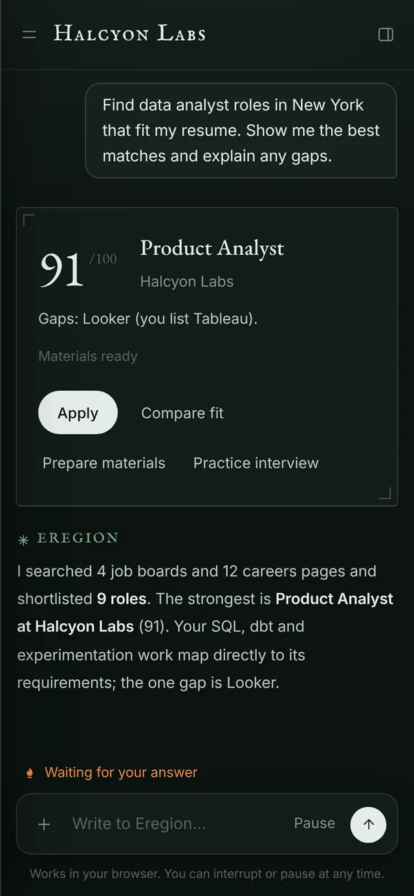

<p align="center">
  <picture>
    <source media="(prefers-color-scheme: light)" srcset="site/assets/readme/banner-light.webp">
    
  </picture>
</p>

<p align="center">
  <a href="#get-started"></a>
  <a href="docs/configuration.md"></a>
  <a href="#deployment-and-compatibility"></a>
  <a href="chrome_extension/README.md"></a>
  <a href="#day-and-night"></a>
</p>

<p align="center">
  <b><a href="#get-started">Get started</a></b> ·
  <a href="docs/usage.md">User guide</a> ·
  <a href="docs/configuration.md">Configuration</a> ·
  <a href="docs/agent-loop.md">Architecture</a> ·
  <b><a href="https://ethany14.github.io/Eregion-Agent/">Website</a></b>
</p>

---

Eregion helps you find relevant roles, understand your fit, prepare application
materials, work through application forms, and practise for interviews. Bring
your resume, describe what you want, and keep the whole search in one workspace.

It runs on your computer with your own model API credentials. Your saved resume,
conversations, documents and application history stay in a local database;
model-assisted work sends relevant content to the providers you configure.

<p align="center">
  <picture>
    <source media="(prefers-color-scheme: light)" srcset="site/assets/screens/chat-light.webp">
    
  </picture>
</p>

## One road, from first sight to offer

Every application travels the same five stations. The agent does the walking;
you decide at the crossings.



| Station | What you need | What Eregion does |
| :-- | :-- | :-- |
| **Sighted** | Find your next role | Browses job boards and company careers pages, builds a shortlist, or schedules recurring recommendations. |
| **Prepared** | Decide where to apply | Compares a job with your resume and shows the score, supporting evidence, gaps, and questions that need your input. |
| | Prepare your materials | Drafts a tailored resume, cover letter and application answers from your source information. Review versions and download resume PDFs. |
| **Sent** | Get through the application | Navigates pages, fills known details, uploads approved documents, and asks for missing answers in chat. |
| | Keep the process moving | Reuses confirmed details and answers, follows multiple applications, and resumes saved work. |
| **In interview** | Prepare for the conversation | Practises job-specific interview questions, with feedback and a final report. |

The agent chooses its next actions and can continue independent work while it
waits for an answer. You can correct it, pause it, or take control of its browser.
**Material approval and final submission always remain explicit review steps.**

## A workspace for the whole search

<table>
  <tr>
    <td width="50%" valign="top">
      <picture>
        <source media="(prefers-color-scheme: light)" srcset="site/assets/screens/home-light.webp">
        
      </picture>
      <h3>📖 Chronicle</h3>
      Your home page: what happened today, and which conversations are waiting on you.
    </td>
    <td width="50%" valign="top">
      <picture>
        <source media="(prefers-color-scheme: light)" srcset="site/assets/screens/road-light.webp">
        
      </picture>
      <h3>🛤️ The Road</h3>
      Every application on one map, board or table, with response rates and weekly activity.
    </td>
  </tr>
  <tr>
    <td width="50%" valign="top">
      <picture>
        <source media="(prefers-color-scheme: light)" srcset="site/assets/screens/forge-light.webp">
        
      </picture>
      <h3>⚒️ The Forge</h3>
      Generated materials are <i>drafted</i>, <i>tempered</i> (every claim checked against your resume) and <i>sealed</i> once you approve them.
    </td>
    <td width="50%" valign="top">
      <picture>
        <source media="(prefers-color-scheme: light)" srcset="site/assets/screens/phone-light.webp">
        
      </picture>
      <h3>💬 Council</h3>
      Your conversations with the agent, in folders, pinned or archived. Works at phone width too.
    </td>
  </tr>
</table>

| Place | Purpose |
| :-- | :-- |
| **Council** | Conversations with the agent |
| **The Road** | Applications and their progress |
| **The Forge** | Materials, versions, verification and approvals |
| **Job alerts** | Recurring searches and recommendation digests |
| **The Lookout** | Browser activity and manual browser control |

<a id="day-and-night"></a>
**Day and Night.** Switch between parchment Day and holly-green Night from the
sidebar; until you choose, Eregion follows your system setting. Conversation
folders and an archive keep the workspace organized as your search grows. See the
[user guide](docs/usage.md) for account sign-in, answer memory, browser takeover
and recovery.

## Get started

> [!NOTE]
> You need **Python 3.12**, **Google Chrome** for browser tasks, and credentials
> for an **OpenAI-compatible** model service. Choose a model that supports tool
> calling and structured output; visual browser backup also requires image input.
> Node.js is only needed for frontend tests.

### 1 · Install

```sh
git clone https://github.com/ethany14/Eregion-Agent.git
cd Eregion-Agent
```

<details open>
<summary><b>macOS or Linux</b></summary>

```sh
python3.12 -m venv .venv
source .venv/bin/activate
python -m pip install -r requirements.txt
```

</details>

<details>
<summary><b>Windows PowerShell</b></summary>

```powershell
py -3.12 -m venv .venv
.\.venv\Scripts\Activate.ps1
python -m pip install -r requirements.txt
```

</details>

### 2 · Connect your model

Create `.env` in the repository root:

```dotenv
LLM_MODEL_ID=your-model-id
LLM_API_KEY=your-api-key
# Set this when your provider uses a custom compatible endpoint.
LLM_BASE_URL=https://your-provider.example/v1
```

Replace the placeholders with your provider's settings. Leave `LLM_BASE_URL` out
if the client's default endpoint is appropriate.

> [!IMPORTANT]
> Keep `.env` private; it is excluded from Git. Jev is optional and is not
> required to use Eregion.

### 3 · Start Eregion

Run from the repository root, in the activated environment:

```sh
python -m alembic upgrade head
python -m uvicorn api.main:app --host 127.0.0.1 --port 8000
```

Open **[localhost:8000/apply](http://localhost:8000/apply)**.

The default browser channel uses your installed Google Chrome. Keep one backend
process running while the agent works or scheduled recommendations are due.

### 4 · Start your first conversation

1. Upload a PDF resume with selectable text using the composer attachment button.
2. Open **Your details** and check the extracted contact information and education.
3. Describe the roles you want, paste a job description, or share a posting link.
4. Review the match, ask for tailored materials, and approve the versions you want.
5. Ask Eregion to prepare the application and review the completed form.

Try a request such as:

> 🔎 *Find data analyst roles in New York that fit my resume. Show me the best
> matches and explain any gaps.*

> ✍️ *Tailor my resume and write a cover letter for this role. Keep every claim
> supported by my experience.*

> ⏰ *Every day at 9 AM in America/New_York, recommend new roles matching
> these preferences.*

## Bring a job from your browser

**Eregion Lens**, the optional Chrome extension, extracts the job on your current
tab, lets you edit the result, and compares it with your saved resume. Open the
saved job in Eregion to continue with materials, applications or interview prep.

→ [Install Eregion Lens](chrome_extension/README.md)

## Deployment and compatibility

| | |
| :-- | :-- |
| 🔒 **Local and single-user** | The server binds to loopback by default. Eregion is not a hosted multi-user service. |
| 🌐 **Your own Chrome** | The current workflow uses local Chrome; a managed cloud browser is not required or included. |
| 🧩 **Browser automation** | Combines form autofill, observed page controls and optional visual backup. Login walls, custom widgets, MFA and CAPTCHA can require your help. |
| ✅ **Checked, not guaranteed** | Generated materials are checked against their cited sources, but review them before use. |
| 📊 **Scores describe evidence** | A match score describes the supplied evidence; it is not a prediction of an employer's decision. |
| 📄 **Text PDFs** | PDF input requires selectable text; scanned resumes need text extraction before upload. |

Public-page checks and synthetic application tests do not establish
compatibility with every ATS or successful submission to every employer.

## Documentation

| Guide | Covers |
| :-- | :-- |
| 📘 [Using Eregion](docs/usage.md) | Daily workflow, approvals, saved answers, alerts and recovery |
| ⚙️ [Configuration](docs/configuration.md) | Model credentials, browser settings, optional Jev and local data |
| 🧭 [Agent architecture](docs/agent-loop.md) | Shared loop, evidence, context, persistence and browser workers |
| ⚡ [Jev and performance](docs/jev-benchmark.md) | Fast-path behaviour, recorded measurements and reproducible comparisons |
| 🛠️ [Development](docs/development.md) | Repository layout, local checks, live evaluation and contributions |
| 🌍 [Website](https://ethany14.github.io/Eregion-Agent/) | Product overview and download · [source and publishing](site/README.md) |

<details>
<summary><b>Run the checks</b></summary>

From the repository root, with dependencies installed:

```sh
python -m pytest -q
node --test "tests/*.mjs"
```

See [Development](docs/development.md) for the opt-in real-Chrome tests.

</details>

The running service also exposes [API documentation](http://localhost:8000/docs)
and a [health endpoint](http://localhost:8000/health).

<p align="center">
  <br>
  <br>
  <sub><i>A little less paperwork. A step closer.</i></sub>
</p>
