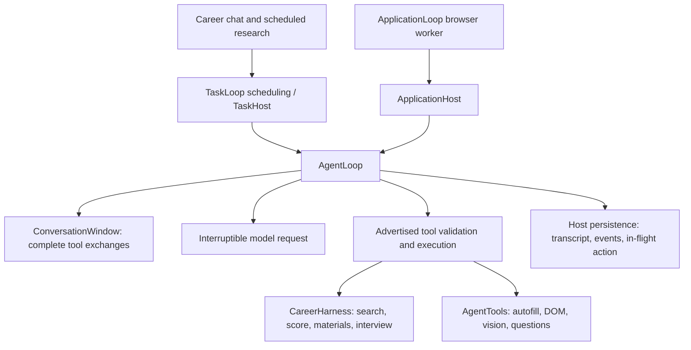

# Shared agent loop

The chat task driver and the application worker now run decisions through
`agent_runtime/loop_engine.py:AgentLoop`. The kernel does not choose job-search
stages or understand ATS fields. Existing domain services remain the tools it can
call, and the model chooses their order.



## Responsibility boundaries

| Component | Responsibility |
| --- | --- |
| `loop_engine.py` | Observe/decide/execute cycle, advertised argument shape, complete tool-result groups, steering checks, lifecycle events, worker yields |
| `loop_context.py` | A bounded window of complete exchanges; excludes screenshots, typed reasoning and credential keys; never duplicates old full observations |
| `loop_model.py` | Cancellable waiting, provider deadlines and thread isolation; detaches obsolete requests so a new user message can proceed |
| `task_host.py` | Conversation persistence, chat messages, questions, plans, background-result waits and completion policy |
| `auto_apply/runner.py` | Application observations, browser-thread ownership, DOM/vision recovery, semantic answer verification and form completion checks |
| Existing repositories and domain tools | Candidate evidence, approved memory, documents, credentials, browser permissions and submission fencing |

The older `tools/loop.py`, resume workflow and persisted tool executor continue to
serve their existing document/session APIs. They are not extra planning loops in
the active career chat. This change does not migrate those APIs or replace their
approval and evidence contracts.

## Runtime behavior

- A normal text answer completes an ordinary chat turn. Only an explicit question
  creates a pending user request. An application progress message is delivered,
  while its host checks whether the form is actually ready before yielding review.
- User messages increment the existing revision. Decisions from a previous
  revision cannot execute. Provider calls already sent may still finish remotely;
  their results are ignored. This is not a provider-side billing cancellation.
- Explicitly declared independent read tools may run in one model turn. They run
  sequentially; browser mutations still require a fresh observation. Deferred
  calls receive results so provider message protocols remain well formed.
- Model retries do not replay completed tools. The application host keeps its
  existing failure recovery and submission checks.
- Each operation is journaled before execution. A restart with an in-flight
  operation exposes uncertainty and asks the model to inspect actual state;
  the kernel never blindly re-executes it. Domain idempotency and the existing
  final-submit fence remain necessary: this is not universal exactly-once delivery.
- A slice yields after twelve decisions; the existing schedulers continue it
  within their total budgets. Yielding does not invent a user question or erase
  successful field bindings.
- `loop_runtime` is a versioned JSON field in the existing state, so no database
  migration is needed. It retains up to eight complete exchanges / 24,000
  serialized characters, eighty metadata events and any in-flight operation.
  Domain history, messages, approved facts and artifacts remain the authoritative
  longer-lived task state. An oversized exchange is omitted whole, not cut into
  invalid tool JSON. This is bounded retention, not an LLM-generated summary.

## Host contract

A host supplies `active`, `revision`, `observe`, `invoke`, `progress`, `on_text`,
`execute`, `action_error`, `after_action`, and `persist`. `Turn` carries its prompt,
current snapshot, advertised tools, revision and optional ephemeral images.
`LoopStop` represents a deliberate stop or handoff, separate from unexpected errors.
Adding another domain requires a host and tools; it does not require editing the
kernel with new workflow stages.

## Design references

The separation between a small loop, steering input, tool execution and lifecycle
events follows the useful structure visible in
[Pi's loop](https://github.com/badlogic/pi-mono/blob/main/packages/agent/src/agent-loop.ts).
Keeping session persistence and interruption concerns separate is also reflected
in [Hermes's runtime](https://github.com/NousResearch/hermes-agent/blob/main/run_agent.py).
The host/session distinction and bounded operational lifecycle are consistent with
[OpenClaw's documented agent loop](https://docs.openclaw.ai/concepts/agent-loop).
These are architectural references; no upstream runtime or new framework dependency
was imported.

## Verification

Run the deterministic scheduler/repository regression checks without pytest:

```powershell
.\.venv\Scripts\python.exe -m unittest discover -s tests -p test_shared_agent_loop.py -v
.\.venv\Scripts\python.exe -m unittest discover -s tests -p test_auto_apply_review_fixes.py -v
```

The opt-in live smoke uses the configured, billable model and actual Chrome. It
intercepts navigation to render a local synthetic two-page application; it uses no
saved candidate data, uploads or external ATS and asserts zero final-submit clicks:

```powershell
$env:NORTHSTAR_SMOKE_DIR = 'C:\path\to\existing\test-artifacts'
.\.venv\Scripts\python.exe scripts\smoke_shared_application_loop.py
```

The initial live run completed autofill, page navigation, semantic answer binding,
second-page filling and final review in five tool calls plus six model calls
(including answer verification), about 17 seconds. A separate isolated instance of
the real chat UI completed a greeting, saved-job lookup and public browser read.
This is targeted coverage of the new kernel and its integrations, not a claim that
every employer site, resume workflow or interview mode has been retested.

## Optional Jev fast decisions (first integration)

The main chat/application planner remains the configured `LLM_*` model. Jev is
an optional capability inside domain tools, not another planner or mandatory
router on every user message. It uses TypeSafe's `/v1/systemone` HTTP API through
the existing httpx dependency; no new framework or database migration is needed.

```dotenv
TYPESAFE_API_KEY="your-key"
TYPESAFE_BASE_URL="https://api.typesafe.ai"
TYPESAFE_DEFAULT_MODEL="jev-latest"
TYPESAFE_ENABLED=false
TYPESAFE_CAREER_ENABLED=false
TYPESAFE_TIMEOUT=2.5
```

`TYPESAFE_ENABLED`, `TYPESAFE_CAREER_ENABLED`, and `TYPESAFE_TIMEOUT` are project settings, not SDK environment
variables. Enabling the feature sends relevant field labels, options and their
confirmed answers to TypeSafe, and job snippets plus search preferences for
screening. The general form/screening scope does not send raw resumes, screenshots, passwords or account
forms. The additional career scope below sends extracted resume evidence and scoped memories. Leave it disabled until that data destination
is approved. Existing `LLM_*` settings are unchanged. Smoke scripts explicitly
enable Jev only in their own processes using synthetic data. They do not modify
`.env`, production profiles or running servers. Pin `TYPESAFE_DEFAULT_MODEL` to
`jev-1.13.0` if calibrating thresholds; `jev-latest` may change underneath them.

### Form choices

`auto_apply/fast_options.py` runs inside `autofill` after existing deterministic
filling (including resume upload). It batches unresolved exposed dropdown choices
against applicable confirmed sources. Matching by exact label or known aliases
remains deterministic. Dynamic menus are probed at most twice per invocation;
up to three bounded rounds allow an exposed category/leaf sequence. Only observed
option IDs can be selected. Labels, source values, revision, and the entire live
option list are checked again after the network call, and the browser value is
verified after clicking. Decisions remain run-local representations, not new
candidate facts. Existing source bindings and final-submit checks still apply.

The initial adoption gate requires confidence >= 0.90 and winning probability
>= 0.95. These are conservative starting values, not an empirically established
accuracy guarantee. Ambiguous/no-match answers and all provider failures return
control to the main LLM. Eligibility, consent, and yes/no interpretation keep
their existing path. Category exploration does not count as a completed answer.

### Job screening

`screen_jobs(urls, query)` accepts up to twenty actually observed browser/search
links or previously retrieved jobs. The host supplies captured titles, locations,
context and any retrieved descriptions; the model cannot invent posting text in
this tool. The query contains role/location/seniority preferences, not contact
details or resume text. Supplementary `search_jobs` also uses this screening.
Results are advisory `strong / possible / weak / unknown` priorities, never the
verified fit score. All candidates remain available, including uncertain ones.
Reading, evidence validation and recommendation gates remain required. Detailed scoring may use
the separately enabled career acceleration below; screening never substitutes for it.
The first gate is confidence >= 0.75 and winning probability >= 0.85. The task
allows at most twenty auxiliary screening evaluations per user revision.

### Failure behavior and observability

`fast_decisions.py` validates every response's IDs, distributions, numbers and
shape. Calls have a short per-operation HTTP timeout with no automatic retries
or redirects. An error opens a 30-second cooldown; results are cached in memory
for five minutes (128 hashed entries, keyed by exact model/input/questions).
Form requests also use the existing interruptible provider wait and model budget.
Unchanged failed mappings are not retried on every loop iteration. Diagnostics
record purpose, model, elapsed time, status, tokens and cache hits, without API
keys or raw provider requests. Application state records `fast_options` timings;
career tasks retain a bounded `fast_decisions` history.

Boolean grounding remains authoritative on the main model. The opt-in smoke
compares Jev against it, but does not change production answers or add a second
verification call to normal applications. Initial testing found a Chinese
negative answer that Jev abstained on while the main model accepted correctly.
The nested referral fixture also required the main model to explore Job Boards;
Jev's uncertain category choice was correctly declined. Fast decisions are an
optimization with a fallback, not a promise to solve all menus.

### Live verification (no pytest)

```powershell
$env:NORTHSTAR_SMOKE_DIR = 'C:\path\to\existing\artifacts'
.\.venv\Scripts\python.exe scripts\smoke_jev.py
.\.venv\Scripts\python.exe scripts\smoke_jev_runtime.py
.\.venv\Scripts\python.exe scripts\smoke_jev_nested.py
```

These use billable configured APIs and real headless Chrome with locally
intercepted pages and synthetic applicants/jobs. Runtime checks inject timeout,
401, 429, malformed responses, changed options, new user input and pause events.
The chat smoke exercises the actual task loop, browser and CareerHarness with
an isolated temporary database. The nested smoke validates uncertain Jev output
falling back to the main model and reaching LinkedIn through Job Boards. All
application checks assert zero final-submit clicks.

Initial measurements on 2026-10-09: ten option questions took about 0.6 seconds
in one Jev request; three synthetic jobs about 0.6 seconds. One Chrome application
comparison took 19.5 seconds / five main-model calls without Jev, versus 16.6
seconds / three main-model calls plus one Jev request after integration fixes.
This is a small smoke sample with variable provider latency, not a benchmark or
real-ATS reliability claim. The last option batch accepted five correct mappings
and deferred five cases (including one correct but low-confidence referral).

References: [TypeSafe API](https://docs.typesafe.ai/api),
[models and limits](https://docs.typesafe.ai/models),
[known limitations](https://docs.typesafe.ai/model-jaggedness/jev-1.13).


### Career decision acceleration (round 2)

The task loop still uses the configured main model for planning, tool selection,
communication, writing, extraction, interview evaluation, factual claim checking,
and nonliteral yes/no grounding. Jev is invoked inside existing capabilities,
not as a compulsory router before every chat message.

| Capability | Jev work | Main-model fallback |
| --- | --- | --- |
| Dropdown filling | Map confirmed answer to observed option | Unknown/ambiguous mapping or provider error |
| Job shortlist | Rank observed posting snippets | Main agent inspects uncertain candidates; all links retained |
| Memory retrieval | Relevance of already allowed, confirmed memories | Entire original candidate set if any decision is uncertain |
| Application question classification | Choose existing semantic category | Uncertain category, including ambiguous personal questions |
| Match assessment | Select exact evidence for simple skill requirements | Complex/partial requirements, years, education, uncertain evidence |

`TYPESAFE_CAREER_ENABLED=true` requires `TYPESAFE_ENABLED=true`. Both must be
explicitly enabled in configuration and the backend restarted to enable these
new career paths. They are disabled by default; benchmark scripts inject their
own enabled service and synthetic data without editing `.env`.

The career scope sends question text, a retrieval query and the already scoped
memory candidates, and validated resume evidence quotes plus job requirements
to `https://api.typesafe.ai`. These fragments can contain personal information.
This is broader than form-option mapping and job-snippet screening; enabling
the general switch alone does not enable it. Existing owner/sensitivity/expiry
filters run before memory selection. Neither benchmark nor fast decisions write
new user facts or consent choices. No resume file, browser image, password, or
verification code is uploaded by this code path.

`fast_semantics.py` batches at most 40 memory candidates. The relevance gate is
confidence >= 0.85 and winning probability >= 0.90, used only for retrieval.
It neither deletes stored memories nor changes their confirmed status. Initial
testing found that passing only uncertain memories to the main model changed
its context, so an uncertain batch now falls back with every original candidate.
Question categories require confidence >= 0.95 and probability >= 0.98. Existing
deterministic legal/logistics/demographic guards and manual-answer policy remain.

`job_agent/fast_match.py` handles at most 40 simple requirements against up to
80 evidence quotes, within the provider adapter's input bound. It picks only
existing quote IDs. Code maps them back to exact original text. Direct decisions
require confidence >= 0.90 and probability >= 0.95. Several valid quotes can split
selection probability; an additional bounded Jev batch can independently verify
the selected quote (confidence >= 0.95, probability >= 0.98). This is a second
decision, not permission to accept the first uncertain choice. Any unresolved
requirements are passed to the main model together in one request. No generated
quote is accepted and no truncated input is treated as proof of absence.

User-confirmation requirements remain unscored and unanswered. Years and degree
comparison use the main model. Existing exact-evidence, tool-name, education,
duration, grouping and required/preferred weighting rules still normalize the
final result. Jev's `Score` primitive never computes the public match score.
Fast assessments use a short evidence summary and per-gap suggestions, while
complex fallback requirements retain main-model suggestions. This is a change
in explanation style, not a replacement for full career coaching.

These confidence thresholds are provisional gates, not measured probabilities
of correctness. Model aliases and latency vary; pin the tested provider version
when using benchmark results to choose thresholds.

Fit analysis now reports `main_model_calls`, `fast_model_calls` and total
`model_calls`; workspace timing also retains per-purpose metadata and fallback
counts. Cache hits consume zero provider calls. Matching mode/model configuration
is included in fit cache identity. Jev HTTP requests participate in the existing
model usage budget and use provider token usage when returned. No prompt, resume,
memory content or API key is included in routing diagnostics.

Additional repeatable checks (billable APIs for the benchmark and quality script):

```powershell
.\.venv\Scripts\python.exe scripts\benchmark_jev.py --output <artifact-directory> --repeats 2 --suite all
.\.venv\Scripts\python.exe scripts\check_jev_routing.py
.\.venv\Scripts\python.exe scripts\quality_jev.py <artifact-directory>\quality.json
```

The benchmark alternates main/Jev order, disables fit caches and clears Jev result
caches before each trial. It measures isolated matching on identical extracted
evidence as well as the full extraction + matching service, and saves all scores,
statuses, quotes, fallbacks and timing. Full cold extraction is nondeterministic;
use the fixed-evidence trials to distinguish matching changes from extraction
variation. Quality holdouts cover negation, partial skills, compound requirements,
tool non-equivalence, translation, quoted instruction injection and consent.
Read `docs/jev-benchmark.md` for measured results and their limitations.


## Latency cleanup

The loop now elides exact duplicate tool results between current history and its
complete transcript, and repeats a user request only when it changes. Legacy and
changed results are retained. Provider waits check revisions at roughly 100 ms,
wake immediately on completion, and always recheck before accepting a response.
Timing records expose payload sizes and available provider token counters.

Resume/JD extraction uses compact provider-only schemas, expanding locally into
the same public evidence contracts. Source validation and score calculation stay
unchanged. See [the latency audit](latency-audit.md) for measurements, limits and
the remaining extraction, asynchronous scoring and streaming work.

## Speed plan implementation

See [the speed implementation report](speed-plan.md) for host-owned mechanical
steps, batching, durable analysis reuse, compact model contracts, optional model
tiers, configuration and measured results. Cold-provider performance targets are
not yet met; the report separates these from verified cache and call reductions.
